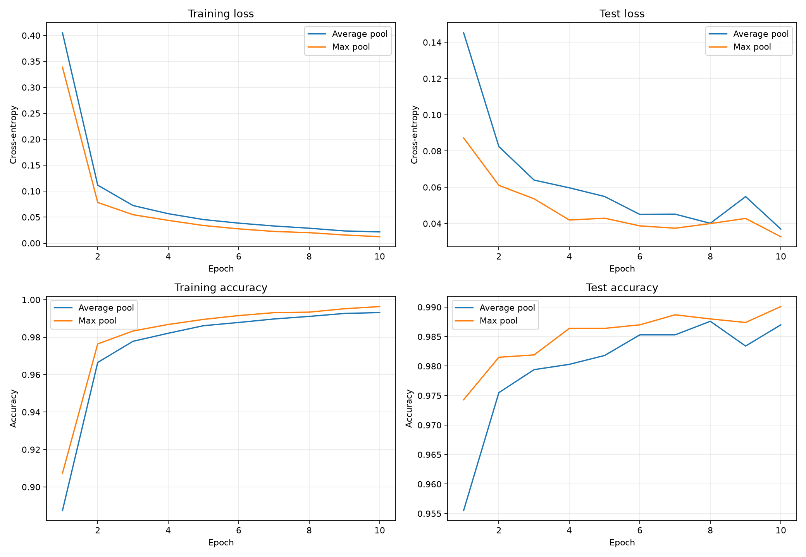
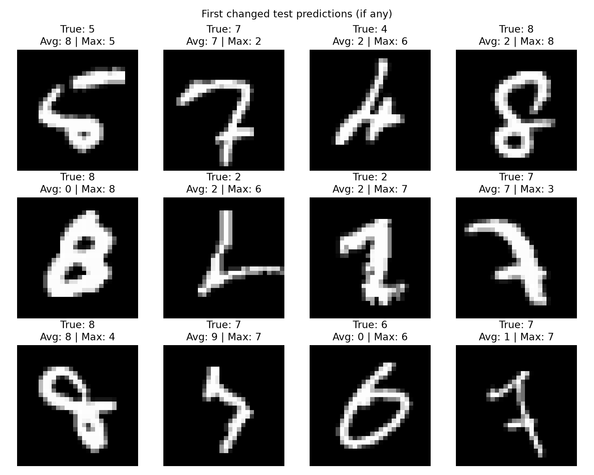

# LeNet MNIST Experiment: Average Pooling vs. Max Pooling

This project was a simple but useful controlled comparison: I trained the same LeNet structure twice on MNIST, changing only the pooling operation. The goal was to see whether swapping average pooling for max pooling made a measurable difference without changing the rest of the setup.

## Objective

The baseline model used average pooling, while the modified model used max pooling. Everything else stayed the same:

- Same MNIST training and test split
- Same random seed: 42
- Same activation: `tanh`
- Same optimizer: Adam
- Same learning rate: 0.001
- Same batch size: 128
- Same number of epochs: 10

This keeps the experiment fair. If the output shifts, it is much more likely to be due to the pooling choice rather than unrelated training differences.

## Model setup

The implementation used a standard LeNet-style CNN for handwritten digits:

```python
class LeNet(nn.Module):
    def __init__(self, pooling="avg"):
        super().__init__()
        if pooling == "avg":
            pool = nn.AvgPool2d(kernel_size=2, stride=2)
        elif pooling == "max":
            pool = nn.MaxPool2d(kernel_size=2, stride=2)

        self.features = nn.Sequential(
            nn.Conv2d(1, 6, kernel_size=5),
            nn.Tanh(),
            pool,
            nn.Conv2d(6, 16, kernel_size=5),
            nn.Tanh(),
            pool,
        )

        self.classifier = nn.Sequential(
            nn.Flatten(),
            nn.Linear(16 * 4 * 4, 120),
            nn.Tanh(),
            nn.Linear(120, 84),
            nn.Tanh(),
            nn.Linear(84, 10),
        )
```

The only architectural difference between the two runs was that one used `AvgPool2d` and the other used `MaxPool2d`.

## Training and evaluation results

The experiment was run on the full MNIST test set, and the final metrics are below.

| Experiment | Pooling | Test accuracy | Test loss | Training time (s) |
|---|---|---:|---:|---:|
| Baseline LeNet | Average | 98.70% | 0.0369 | 307.2 |
| Modified LeNet | Max | 99.01% | 0.0327 | 319.0 |

### Key takeaways from the metrics

- Max pooling improved test accuracy by 0.31 percentage points.
- Test loss went down from 0.0369 to 0.0327.
- The modified model made different predictions on 109 out of 10,000 test images (1.09%).
- The model improved on 68 previously incorrect examples.
- It made 37 examples worse.
- Mean prediction confidence increased by 0.0023.
- Both models had the same parameter count: 44,426 trainable parameters.

## Training curves

These plots show how the two models behaved over the 10 training epochs.



The curves are pretty clean overall, and the max-pooling version stayed slightly ahead in test accuracy after the early epochs. That said, the difference is modest, which makes sense because the experiment only altered one component of the architecture and used a single random seed.

## Changed predictions

This is the part I found most interesting: the models did not behave identically, even though they were mostly similar. A few digits were reclassified, and some of those were likely ambiguous images where the local features mattered more.



The changed predictions were measured as:

- 109 total prediction changes out of 10,000 images
- 68 incorrect-to-correct transitions
- 37 correct-to-incorrect transitions

That pattern is a nice sign: the max-pooling version corrected more cases than it broke.

## Practical interpretation

This experiment suggests that max pooling gave the LeNet model a slight edge on MNIST under the same training setup. The improvement was not dramatic, but it was consistent: better accuracy, lower loss, and more corrections than mistakes.

At the same time, this is still a single-seed result. It is good evidence for this specific run, but not proof that max pooling is always better than average pooling across every dataset or every training setup. The takeaway is more along the lines of:

> For this controlled LeNet experiment on MNIST, max pooling performed a little better than average pooling under the same conditions.

## Final note

The pipeline was kept simple and controlled on purpose. The point was not to chase a huge performance jump, but to show how one design choice can noticeably change the output while the rest of the model stays fixed. That is a very solid way to understand CNN behavior in practice.

## Reproducibility

The experiment was implemented in a single script and can be reproduced by running:

```bash
python lenet_mnist.py
```

This script downloads MNIST on first use and saves the training curves, prediction comparison, and summary metrics automatically.
